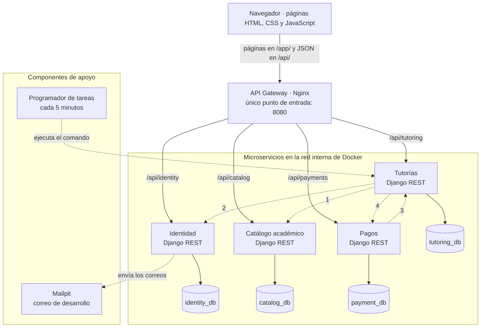

# Plataforma de Tutorías entre Estudiantes

Plataforma web que conecta a estudiantes de Duoc UC que necesitan apoyo en una
asignatura con compañeros que la dominan.

Proyecto APT · Capstone (PTY4614) · Ingeniería en Informática · Duoc UC · 2026

## Descripción

### Qué problema resuelve

Los estudiantes de Duoc UC recurren con frecuencia a compañeros de cursos
superiores para reforzar las asignaturas que les cuestan, pero esa búsqueda
ocurre de manera informal y dispersa: grupos de mensajería, recomendaciones de
pasillo y contactos personales. No existe un punto centralizado dentro de la
institución donde un estudiante pueda encontrar quién domina una asignatura,
conocer su reputación y coordinar un horario. La ayuda existe, pero no se
encuentra.

### Qué hace

La plataforma centraliza la oferta y la demanda de apoyo académico entre pares.
El producto mínimo viable (MVP) considera:

- Registro con el correo institucional @duocuc.cl, verificado con un enlace de
  un solo uso, e inicio y cierre de sesión.
- Perfil con carrera, nivel y sede.
- Catálogo académico con carreras, sedes, mallas, semestres y asignaturas. El
  modelo admite las 92 carreras de Duoc UC y parte con 3 a 5 carreras
  completas, cargadas desde archivos CSV.
- Declaración de las asignaturas en que un estudiante ofrece tutorías, con la
  tarifa que él mismo fija (puede ser $0). Solo se habilitan asignaturas de su
  malla ubicadas en semestres anteriores a su nivel.
- Publicación de bloques de disponibilidad, búsqueda de tutores por asignatura,
  solicitud de tutoría, confirmación o rechazo, y cancelación.
- Avisos por correo: al tutor cuando recibe una solicitud y al estudiante
  cuando se la confirman o rechazan.
- Historial de las tutorías solicitadas e impartidas.
- Evaluación de 1 a 5 después de cada sesión, con comentario opcional, y
  reputación visible de cada tutor.
- Pago simulado de la reserva, con reintento y reembolso simulado al cancelar.
- Panel de administración para gestionar usuarios y catálogo, y retirar
  evaluaciones.

La plataforma agenda la tutoría; la sesión ocurre de forma presencial o por un
enlace externo que el tutor indica al confirmar. Quedan fuera de esta versión
la videollamada integrada, el chat interno, la aplicación móvil nativa, los
pagos con dinero real y la integración con los sistemas académicos de Duoc UC,
incluido su inicio de sesión institucional.

### A quién va dirigido

A los estudiantes de Duoc UC. Estudiante y tutor no son cuentas distintas: una
misma persona puede pedir ayuda en los ramos que le cuestan y ofrecerla en los
de semestres anteriores al que cursa.

| Rol           | Qué hace en la plataforma                                                                                             |
| ------------- | --------------------------------------------------------------------------------------------------------------------- |
| Estudiante    | Busca tutores por asignatura, solicita una tutoría, paga (simulado), cancela o retira su solicitud y evalúa al tutor. |
| Tutor         | Declara asignaturas y tarifa, publica su disponibilidad, acepta o rechaza solicitudes y ve su reputación.             |
| Administrador | Gestiona usuarios y catálogo académico, retira evaluaciones y revisa la actividad del sistema.                        |

## Tecnologías utilizadas

| Capa                 | Tecnología                                                                                                                            |
| -------------------- | ------------------------------------------------------------------------------------------------------------------------------------- |
| Lenguajes            | Python 3.12 en el backend; JavaScript, HTML y CSS en el frontend                                                                      |
| Backend              | Django 5.2 y Django REST Framework 3.16, servidos con Gunicorn                                                                        |
| Frontend             | HTML, CSS y JavaScript sin framework, servidos por el gateway en `/app/` (la alternativa que dejó prevista AD-12, en lugar del plan con React y Vite) |
| Base de datos        | PostgreSQL 16, una base independiente por microservicio                                                                               |
| API Gateway          | Nginx 1.27                                                                                                                            |
| Autenticación        | Tokens JWT firmados con RS256: los emite Identidad, y Tutorías los verifica con la clave pública (HU-05 y HU-17)                     |
| Correo               | Mailpit como servidor de correo de desarrollo                                                                                         |
| Contenedores         | Docker y Docker Compose: un Dockerfile por servicio y un `docker-compose.yml` que levanta el sistema completo                         |
| Calidad              | pytest, pytest-django y pytest-cov; ruff y black en Python. El frontend todavía no tiene pruebas automáticas: la integración continua salta ese paso mientras no exista `frontend/package.json` |
| Integración continua | GitHub Actions                                                                                                                        |
| Cloud                | No se usa. El sistema completo corre en contenedores Docker en cualquier computador; GitHub aloja el código y la integración continua |

## Instrucciones para ejecutar el proyecto localmente

### Requisitos

| Herramienta    | Versión mínima | Cómo comprobarlo                                  |
| -------------- | -------------- | ------------------------------------------------- |
| Git            | 2.40           | `git --version`                                   |
| Docker Desktop | 4.30           | `docker version` (línea `Server: Docker Desktop`) |
| Docker Compose | 2.27           | `docker compose version`                          |

En Windows, Docker Desktop necesita WSL 2 activado. El sistema completo usa
alrededor de 3 GB de memoria; si tu computador tiene 8 GB, cierra el navegador
mientras lo levantas la primera vez.

### Levantar el sistema

```bash
git clone https://github.com/Bacchi701/Plataforma-web-tutorias.git
cd Plataforma-web-tutorias
cp .env.example .env          # PowerShell: Copy-Item .env.example .env
docker compose up -d --build
```

`docker-compose.yml` construye cada servicio desde su
`services/<servicio>/Dockerfile` y levanta diez contenedores: el gateway, los
cuatro servicios, sus cuatro bases de datos y la bandeja de correo de
desarrollo. La primera vez tarda entre 3 y 6 minutos porque construye las
imágenes. Las siguientes, menos de un minuto.

### Comprobar que está arriba

Abre <http://localhost:8080>: la página muestra los cuatro servicios con su
estado. Uno por uno:

| Servicio           | URL                                            |
| ------------------ | ---------------------------------------------- |
| Identidad          | <http://localhost:8080/api/identity/v1/estado> |
| Catálogo académico | <http://localhost:8080/api/catalog/v1/estado>  |
| Tutorías           | <http://localhost:8080/api/tutoring/v1/estado> |
| Pagos              | <http://localhost:8080/api/payments/v1/estado> |

Cada uno responde algo así:

```json
{"servicio": "identity", "estado": "ok", "base_de_datos": "ok", "version": "0.1.0"}
```

Ningún servicio ni base de datos publica un puerto a tu computador: el puerto
8080 del gateway es la única puerta de entrada, que es la condición del
criterio de aceptación CA8.

En `develop` están las historias terminadas (ver «Estado del desarrollo»), y
desde ahí se prueba la demo.

### Probar la demo

Con los datos de ejemplo se puede recorrer lo que ya está en `develop`:
registro con el correo institucional, verificación por correo, inicio de
sesión, perfil, catálogo, disponibilidad del tutor y búsqueda de tutores. Con
los PR del 29-10 se suman declarar desde «Mi perfil» las asignaturas que se
enseñan, los tutores de cada asignatura y la búsqueda de tutores por nombre y
por evaluación.

En Windows (PowerShell), desde la carpeta del repositorio:

```powershell
git switch develop
git pull --ff-only
if (-not (Test-Path .env)) { Copy-Item .env.example .env }
docker compose build identity
docker compose run --rm --no-deps -v "${PWD}\keys:/claves" --entrypoint python identity manage.py generar_claves_jwt --carpeta /claves
docker compose up -d --build --wait
docker compose up -d --force-recreate --wait identity tutoring
docker compose restart gateway
powershell -ExecutionPolicy Bypass -File .\scripts\cargar_datos_demo.ps1
```

En macOS, en Linux o en Git Bash de Windows, un script hace todo lo anterior:

```bash
git switch develop && git pull --ff-only
sh scripts/levantar_demo.sh
```

- El comando de las claves genera el par que firma los tokens. La clave
  privada queda en `keys/` y no se sube al repositorio (la excluye
  `.gitignore`); la pública cambia, y Git la mostrará modificada: es normal y
  no hay que subirla. Si ya existe una clave privada, el comando no la
  reemplaza; con `--forzar` la reemplaza y cierra todas las sesiones.
- `docker compose up -d --force-recreate --wait identity tutoring` hace que
  Identidad y Tutorías lean las claves recién generadas: las guardan en memoria
  al arrancar. Después de un `--forzar` hay que repetirlo, junto con el reinicio
  del gateway.
- `docker compose restart gateway` hace que el gateway vuelva a encontrar a
  los servicios: Nginx busca su dirección solo al arrancar.
- La carga de los datos de ejemplo vacía y vuelve a llenar las cuatro bases.
  Se puede repetir las veces que haga falta. Las cuentas, los tutores y las
  reservas son ficticios.
- En macOS, `levantar_demo.sh` deja `COOKIE_REFRESH_SEGURA=0` en el `.env`:
  Safari no guarda cookies seguras en `http://localhost`, y sin esa cookie la
  sesión no se recupera al recargar la página.

Después abre:

| Qué                                    | Dirección                                      |
| -------------------------------------- | ---------------------------------------------- |
| Estado de los cuatro servicios         | <http://localhost:8080/>                       |
| Portada                                | <http://localhost:8080/app/index.html>         |
| Asignaturas, mallas y sus tutores      | <http://localhost:8080/app/asignaturas.html>   |
| Tutores: los mejor evaluados y la búsqueda por nombre | <http://localhost:8080/app/tutores.html> |
| Registro con correo @duocuc.cl         | <http://localhost:8080/app/registro.html>      |
| Bandeja de correo (verificación)       | <http://localhost:8025>                        |
| Inicio de sesión                       | <http://localhost:8080/app/login.html>         |
| Mi perfil y las asignaturas que enseño (con sesión) | <http://localhost:8080/app/perfil.html> |
| Mi disponibilidad (con sesión, tutores) | <http://localhost:8080/app/disponibilidad.html> |

Cuentas de ejemplo, todas con la clave `Tutorias2026`:

| Cuenta                     | Qué muestra                                                                 |
| -------------------------- | --------------------------------------------------------------------------- |
| `valentina.demo@duocuc.cl` | Tutora de Ingeniería en Informática, con asignaturas declaradas y bloques publicados. |
| `camila.demo@duocuc.cl`    | Estudiante de Ingeniería en Informática, en segundo semestre: puede ofrecer tutorías de las asignaturas del primero. |
| `matias.demo@duocuc.cl` y `fernanda.demo@duocuc.cl` | Otros dos tutores.                             |
| `diego.demo@duocuc.cl`     | Estudiante de primer semestre: todavía no puede ofrecer tutorías.           |
| `tomas.demo@duocuc.cl`     | Cuenta sin verificar: no puede iniciar sesión.                              |
| `josefa.demo@duocuc.cl`    | Cuenta desactivada: «Tu cuenta está desactivada.»                           |

Una cuenta nueva se crea en el registro con cualquier correo que termine en
`@duocuc.cl`; el enlace de verificación llega a la bandeja de desarrollo, no a
una casilla real.

### Variables de entorno

Todas viven en un solo archivo `.env` en la raíz, que se crea copiando
`.env.example` y nunca se sube al repositorio.

| Variables                                                        | Para qué sirven                                                                                     |
| ---------------------------------------------------------------- | --------------------------------------------------------------------------------------------------- |
| `PUERTO_GATEWAY`                                                 | Puerto del gateway en tu computador (8080 por defecto).                                             |
| `DJANGO_SECRET_KEY`, `DJANGO_DEBUG`, `DJANGO_ALLOWED_HOSTS`      | Configuración común de los cuatro servicios.                                                        |
| `IDENTITY_DB_*`, `CATALOG_DB_*`, `TUTORING_DB_*`, `PAYMENT_DB_*` | Nombre, usuario y contraseña de la base de cada servicio.                                           |
| `PUERTO_BANDEJA`                                                 | Puerto de la bandeja de correo de desarrollo (8025 por defecto).                                    |
| `EMAIL_*` y `CORREO_REMITENTE`                                   | Vacías por defecto, así todo el correo cae en Mailpit. Solo se llenan para la prueba de envío real. |
| `URL_FRONTEND`, `COOKIE_REFRESH_SEGURA`                          | La página a la que lleva el enlace del correo de verificación, y si la cookie de renovación de la sesión va marcada como segura (`1`, por defecto). En macOS va en `0` (ver «Probar la demo»). |

### Bandeja de correo de desarrollo

Todo correo que envía Identidad cae en Mailpit y se ve en
<http://localhost:8025>. Nada sale a internet: ningún correo llega a una
persona real. Para mandar uno de prueba:

```bash
docker compose exec identity python manage.py enviar_correo_prueba
```

La bandeja publica un segundo puerto, solo para tu computador (127.0.0.1). Es
una herramienta de desarrollo y no forma parte del sistema evaluado (Pilar 2,
sección 10). Se vacía cada vez que se reinicia su contenedor.

Mailpit no entrega a casillas reales. Para el envío real que exige el supuesto
S-02 del Pilar 5 (un correo de verificación que llegue a una casilla
@duocuc.cl) se llenan en el `.env` de un solo computador las variables
`EMAIL_HOST`, `EMAIL_PORT`, `EMAIL_HOST_USER`, `EMAIL_HOST_PASSWORD`,
`EMAIL_USE_TLS` (con el valor `1` si el servidor usa TLS) y
`CORREO_REMITENTE`, con una cuenta SMTP gratuita. Después,
`docker compose up -d` aplica los cambios a Identidad (`docker compose restart`
no relee el `.env`), y la prueba se envía con
`docker compose exec identity python manage.py enviar_correo_prueba --para tu.casilla@duocuc.cl`.
Esas claves nunca se suben al repositorio.

## Integrantes del equipo con sus roles

| Integrante       | Autor en Git  | Rol en Scrum                                                    | Responsabilidades                                                                                                                                                                                                                                                   |
| ---------------- | ------------- | --------------------------------------------------------------- | ------------------------------------------------------------------------------------------------------------------------------------------------------------------------------------------------------------------------------------------------------------------- |
| Bryan Bacchi     | `Bacchi701`   | Líder del proyecto: Scrum Master, Product Owner y desarrollador | Dueño de los servicios de Identidad (con los avisos por correo) y Pagos. Responsable de la infraestructura: contenedores, gateway, correo de desarrollo e integración continua. Coordina al equipo, consolida la documentación y es el interlocutor con el docente. |
| Francisco Tejeda | `cacot12`     | Equipo de desarrollo                                            | Dueño del Catálogo académico y la carga de mallas, del módulo de evaluaciones y reputación, y del panel de administración. Es el segundo responsable de infraestructura.                                                  |
| Damaris Iriarte  | `Damaris2023` | Equipo de desarrollo                                            | Dueña del servicio de Tutorías: perfiles de tutor, disponibilidad, búsqueda, reservas y cancelaciones. Responsable del sistema visual del frontend.                                                                                                                 |

Cada integrante es dueño de sus servicios de punta a punta (modelo de datos,
API, pruebas y pantallas), y cada servicio tiene un segundo responsable que
sabe levantarlo y revisarlo: Damaris en Identidad y Pagos, Bryan en Catálogo y
evaluaciones, y Francisco en Tutorías e infraestructura. Con tres integrantes,
los roles de Scrum Master y Product Owner se concentran en el líder, y así
queda escrito.

Para equilibrar la carga en el sprint 3, Francisco tomó la búsqueda de
tutores (HU-20), que es de Tutorías, y Bryan, las mejoras que salieron de la
revisión de la plataforma con el equipo (HU-38 a HU-41). Las excepciones
quedan registradas en Jira.

## Metodología de trabajo del equipo: Scrum

El equipo trabaja con Scrum, adaptado a tres personas.

- **Sprints de dos semanas.** Cuatro sprints, del 21 de septiembre al 8 de
  noviembre de 2026 (el último dura una semana), precedidos por una semana de
  planificación y una de cimientos. El 25 de septiembre el profesor fijó el
  8 de noviembre como límite del desarrollo, y el plan pasó de cinco sprints a
  cuatro.
- **Product Backlog.** El alcance se priorizó con MoSCoW. El bloque Must, que
  es el MVP, se descompuso en 37 historias de usuario (13 de ellas técnicas),
  estimadas en horas (355 h en total) y agrupadas en nueve épicas. Los Should
  entran de a uno, y solo si la velocidad medida deja espacio.
- **Cierre de sprint** (90 minutos, cada dos semanas): Sprint Review, en la que
  cada dueño de servicio demuestra lo suyo funcionando; retrospectiva; reporte
  al docente; y Sprint Planning del sprint siguiente, sobre las horas que cada
  integrante declara. Al abrir cada sprint se congelan los contratos de la API
  que ese sprint va a usar.
- **Seguimiento en Jira.** Desde el sprint 2, por pedido del profesor, el
  backlog, el sprint y el Daily están en Jira (proyecto «Tutorias», clave
  SCRUM). El Daily es escrito: cada integrante deja un comentario por día en
  la tarea del Daily de cada sprint (SCRUM-51 en el sprint 2 y SCRUM-69 en el
  sprint 3), con lo que hizo, lo que hará y sus bloqueos. Al cierre de cada
  sprint se comparan las horas planificadas con las trabajadas y con las
  historias terminadas.
- **Definición de Listo (Definition of Done).** Una historia está terminada
  cuando cumple su criterio de aceptación sobre el sistema levantado, tiene
  pruebas automáticas de sus reglas de negocio, la integración continua está
  en verde, otro integrante la aprobó, el contrato en `docs/api` refleja la API
  real, el sistema se levanta desde un clon limpio y la historia está fusionada
  a `develop`.

| Etapa         | Fechas                           | Objetivo                                                                        |
| ------------- | -------------------------------- | ------------------------------------------------------------------------------- |
| Planificación | 7 al 13 de septiembre            | Cinco pilares de planificación, repositorio y primeras maquetas                 |
| Cimientos     | 14 al 20 de septiembre           | El sistema completo se levanta con un comando                                   |
| Sprint 1      | 21 de septiembre al 4 de octubre | Registro, verificación de correo e inicio de sesión, sobre la base del frontend |
| Sprint 2      | 5 al 18 de octubre               | Cerrar lo abierto del sprint 1; perfil, catálogo cargado, declaración de asignaturas y disponibilidad |
| Sprint 3      | 19 de octubre al 1 de noviembre  | El flujo de reservas: declarar asignaturas, solicitar, confirmar o rechazar y pago simulado, más 3 a 5 carreras reales |
| Sprint 4      | 2 al 8 de noviembre              | Lo que queda del MVP: cancelación con reembolso, cierre y expiración automáticos, evaluaciones, avisos por correo, panel de administración, sistema visual y pruebas de extremo a extremo; el desarrollo se congela el 8 de noviembre |
| Cierre        | 9 al 21 de noviembre             | Informe final y ensayo de la demostración                                       |

El 23 de octubre el sprint 3 se reenfocó en el flujo de reservas, y lo demás
pasó al sprint 4. En la semana del 26 de octubre el equipo revisó la
plataforma funcionando y agregó siete historias al backlog (HU-38 a HU-44); las
cuatro primeras entraron al sprint 3. Si lo que queda del MVP no alcanza a
terminarse en el sprint 4, se aplica el orden de recorte del Pilar 1
(sección 8.3).

**Flujo en Git (GitFlow reducido).** `main` guarda la última versión
presentable y recibe `develop` al cierre de cada sprint, con su etiqueta (v0.1,
v0.2, v0.3 y v1.0). `develop` integra el trabajo del sprint. Cada historia nace de
`develop` en una rama corta (por ejemplo, `feat/HU-04-registro-usuario`) y
vuelve por Pull Request, con la integración continua en verde y la aprobación
de otro integrante.

## Arquitectura de la solución

Arquitectura de microservicios: cuatro servicios en Django REST Framework
detrás de un API Gateway en Nginx, cada uno con su propia base de datos
PostgreSQL, todo orquestado con Docker Compose.



El diagrama muestra el MVP completo. Las páginas del frontend las sirve el
propio gateway en `/app/` (la alternativa de AD-12), y el programador de tareas llega
con HU-37. Las flechas continuas son el tráfico del cliente, que siempre entra
por el gateway, y el acceso de cada servicio a su propia base. Las punteadas
son llamadas internas por la red privada:

| N.º | Llamada              | Para qué                                                                |
| --- | -------------------- | ----------------------------------------------------------------------- |
| 1   | Tutorías → Catálogo  | Valida la asignatura contra la malla y el nivel del usuario (RN-01).    |
| 2   | Tutorías → Identidad | Obtiene los datos del usuario y pide el envío de los avisos por correo. |
| 3   | Pagos → Tutorías     | Consulta la reserva y avisa el resultado del pago.                      |
| 4   | Tutorías → Pagos     | Pide el reembolso al cancelar una reserva pagada.                       |

Qué hace cada servicio:

| Servicio           | Prefijo            | Responsabilidad                                                                                                                           | Base de datos |
| ------------------ | ------------------ | ----------------------------------------------------------------------------------------------------------------------------------------- | ------------- |
| Identidad          | `/api/identity/v1` | Registro, verificación del correo institucional, sesión y tokens, datos del usuario, marca de administrador y envío de todos los correos. | `identity_db` |
| Catálogo académico | `/api/catalog/v1`  | Carreras, sedes, mallas, semestres, asignaturas y prerrequisitos; búsqueda de asignaturas e importación desde CSV.                        | `catalog_db`  |
| Tutorías           | `/api/tutoring/v1` | Perfiles de tutor y tarifas, disponibilidad, búsqueda de tutores, reservas y su ciclo de vida, evaluaciones y reputación.                 | `tutoring_db` |
| Pagos              | `/api/payments/v1` | Pago simulado de una reserva, su estado y el reembolso. Es un componente desactivable.                                                    | `payment_db`  |

Decisiones que sostienen el diseño:

- **Un solo punto de entrada.** El gateway es el único componente del sistema
  que publica un puerto (8080). Los servicios y las bases viven en una red
  interna de Docker y no son alcanzables desde fuera; la bandeja de correo de
  desarrollo abre otro puerto, solo en 127.0.0.1.
- **Cada servicio es dueño de sus datos.** Ninguno consulta la base de otro;
  todo cruce ocurre por la API REST del servicio dueño del dato.
- **Comunicación síncrona REST con JSON.** Hay cuatro llamadas entre
  servicios, numeradas en el diagrama, todas por la red interna de Docker y
  con 3 segundos de espera: si el otro servicio no responde, la petición
  termina en un 503 que dice cuál falló.
  - Cuando los datos son del propio usuario, se usan las rutas públicas. Para
    declarar una asignatura (HU-14) y poner al día la copia de sus datos
    (HU-41), Tutorías le pide a Identidad `GET /yo` con el mismo token del
    usuario, y a Catálogo la malla de su carrera, que es pública (llamadas 1
    y 2).
  - Lo que necesite datos de otro usuario, como los avisos por correo (HU-16 y
    HU-21) y la sincronización de las copias (HU-19), y las llamadas 3 y 4,
    entre Pagos y Tutorías (HU-23 y HU-28), irá por rutas `/internal`: no
    pasan por el gateway, no viajan con el token del usuario y se autentican
    con una clave de servicio en una cabecera.
- **Autenticación distribuida.** Solo Identidad emite los tokens JWT, firmados
  con RS256. Los servicios con rutas que piden sesión verifican la firma con la
  clave pública: hoy Tutorías, y Pagos desde HU-23. Catálogo es de solo
  lectura y no pide token.
- **Copias de lectura.** Tutorías guarda una copia de los datos del usuario y
  de la asignatura que necesita para resolver la búsqueda de tutores sin una
  llamada HTTP por resultado. Se acepta consistencia eventual: la copia del
  usuario se pone al día cuando abre o guarda «Mi perfil» o declara una
  asignatura, y el programador de tareas refresca las demás.
- **Componentes de apoyo.** Mailpit recibe los correos en desarrollo sin
  enviarlos a personas reales, y el programador de tareas ejecuta cada cinco
  minutos los comandos de Tutorías que cierran reservas, expiran solicitudes y
  sincronizan las copias de lectura.

Las decisiones de arquitectura con sus alternativas, los contratos de interfaz
y el modelo de datos completo están en el Pilar 2 y su anexo A, en
[`docs/planificacion/`](docs/planificacion/). Los diagramas entidad-relación
de las cuatro bases, con el modelo implementado (la revisión de normalización
del 30 de septiembre y la columna `area` de HU-12), están en
[`docs/diagramas/`](docs/diagramas/).

## Estructura del repositorio

```text
Fase 1/              evidencias de la Fase 1 del Capstone (grupales e individuales)
Fase 2/              evidencias de la Fase 2: individuales, grupales y del proyecto
.github/workflows/   canal de integración continua
docs/                planificación, diagramas, contratos OpenAPI, decisiones y evidencia
infra/nginx/         configuración del gateway y página de estado
infra/postgres/      reservada para scripts de inicialización de PostgreSQL (hoy vacía)
services/            identity, catalog, tutoring y payments, cada uno con su Dockerfile
data/seeds/demo/     datos de ejemplo de las cuatro bases y la prueba de sus restricciones
keys/                clave pública de firma de tokens (la privada no se versiona)
scripts/             levantar la demo, cargar los datos de ejemplo y probar las restricciones
frontend/            páginas del frontend (HTML, CSS y JavaScript), servidas en /app/
docker-compose.yml   levanta el sistema completo
.env.example         variables de entorno de ejemplo, sin secretos
```

## Estado del desarrollo

Al 29 de octubre de 2026, en el sprint 3:

- **En `develop`:** los cimientos (HU-01) y el correo de desarrollo (HU-02);
  el contrato de Identidad (HU-03); el registro con verificación del correo
  (HU-04), el inicio y cierre de sesión (HU-05) y sus pantallas (HU-09); las
  páginas servidas en `/app/` (HU-06); los modelos de Catálogo (HU-07),
  Tutorías (HU-08) y Pagos (HU-23); el perfil con carrera, nivel y sede
  (HU-10); la API de Catálogo (HU-12); los bloques de disponibilidad (HU-15);
  la verificación del token en Tutorías (HU-17); la búsqueda de tutores
  (HU-20) y sus pantallas (HU-18; solicitar desde el perfil llega con HU-21),
  y los datos de ejemplo con los scripts de
  la demo.
- **Con los PR del 29-10:** declarar desde «Mi perfil» las asignaturas que se
  enseñan, con su tarifa (HU-14), y que el nombre editado llegue a la búsqueda
  (HU-41); los tutores de cada asignatura y la búsqueda de tutores por nombre
  y por evaluación (HU-40); los pasos del inicio con su detalle y las etiquetas
  de asignaturas en el perfil del tutor (HU-38 y HU-39), y la sesión que se
  renueva una sola vez por página.
- **Sprint 3, pendiente:** solicitar una tutoría (HU-21), confirmarla o
  rechazarla (HU-22) y el pago simulado (HU-23 y HU-24), más el cargador del
  catálogo desde CSV (HU-07) y de 3 a 5 carreras reales (HU-13).
- **Backlog nuevo:** el buzón de avisos (HU-42) y recuperar la contraseña
  (HU-43), si queda capacidad en el sprint 4, y ofrecer asignaturas
  aprobadas con evidencia (HU-44), que se decide con el equipo.
- **Pendiente:** las versiones de `main` (v0.1 y v0.2), que no se publicaron
  al cierre de los sprints 1 y 2.
- **Alcance:** desde el 5 de octubre, de forma provisoria, el panel de
  administración se limita a consultar y desactivar usuarios (escalón 3 del
  plan de recorte). El pago con Mercado Pago en modo de prueba queda en el
  backlog, solo si sobra tiempo.
- **Más adelante:** el programador de tareas llega con HU-37, en el sprint 4.

## Comandos del día a día

```bash
docker compose ps                  # qué hay levantado y cómo está
docker compose logs -f identity    # seguir los registros de un servicio
docker compose restart identity    # reiniciar uno (no relee el .env)
docker compose down                # apagar, conservando los datos
docker compose down -v             # apagar y BORRAR las cuatro bases
docker compose up -d --build       # reconstruir después de cambiar código
docker compose restart gateway     # después de reconstruir: vuelve a encontrar los servicios
```

## Problemas frecuentes

**El puerto 8080 está ocupado** (`port is already allocated`, `address already
in use` u `Only one usage of each socket address`). Otro programa lo está
usando. En tu `.env`, cambia `PUERTO_GATEWAY=8090` y
`URL_FRONTEND=http://localhost:8090/app`, vuelve a levantar y usa 8090 en las
direcciones de este README.

**`port is already allocated` o `bind` en el puerto 8025.** Lo mismo con la
bandeja de correo: cambia `PUERTO_BANDEJA` en tu `.env` a 8026 y vuelve a
levantar. La bandeja queda en <http://localhost:8026>.

**Un servicio queda en `unhealthy`.** Mira sus registros con
`docker compose logs identity`. Casi siempre es una variable que falta en el
`.env`: compara tu archivo con `.env.example`.

**En la demo, el inicio de sesión dice «No existe /app/keys/jwt_private.pem».**
Faltan las claves de los tokens. En Windows, corre el comando de las claves de
«Probar la demo», después `docker compose up -d --force-recreate --wait identity tutoring`
y `docker compose restart gateway`. En macOS o Linux, `sh scripts/levantar_demo.sh`
hace todo.

**`localhost:8080` responde 502, o una página dice «No pudimos…», después de
reconstruir un servicio.** El gateway sigue buscando al servicio en su
dirección anterior: `docker compose restart gateway` y recarga la página.

**Al cambiar de página se cerró la sesión.** Pasa si se cambia de página
mientras la anterior todavía renueva la sesión. Espera el «Hola, …» del
encabezado antes de cambiar de página.

**La búsqueda de asignaturas no encuentra «programacion».** Todavía distingue
las tildes: escribe la palabra con su tilde, o usa una que no lleve, como
«datos».

**El inicio de sesión dice «No se pudo iniciar sesión.» aunque la clave esté
bien.** Si hubo varios intentos seguidos, es el límite del gateway: cinco por
minuto desde el mismo computador. Espera un minuto y vuelve a intentarlo. Si
dice «No existe /app/keys/…», faltan las claves (ver el punto de las claves).

**El computador se queda sin memoria.** Con WSL 2, la memoria que puede usar
Docker se fija en el archivo `%UserProfile%\.wslconfig`: agrega las líneas
`[wsl2]` y `memory=4GB`, ejecuta `wsl --shutdown` y vuelve a abrir Docker
Desktop. En macOS, la memoria se fija en Docker Desktop, en Settings →
Resources. Si aun así no alcanza, está prevista la alternativa de la sección 10
del Pilar 2: una sola instancia de PostgreSQL con cuatro bases y cuatro
usuarios sin permisos cruzados.

## Documentación del proyecto

| Documento                                                                       | Dónde está                                                |
| ------------------------------------------------------------------------------- | --------------------------------------------------------- |
| Planificación en cinco pilares: alcance, arquitectura, equipo, tiempo y calidad | [`docs/planificacion/`](docs/planificacion/)              |
| Modelo de datos detallado (anexo A del Pilar 2)                                 | [`docs/planificacion/`](docs/planificacion/)              |
| Diagramas entidad-relación de las cuatro bases                                  | [`docs/diagramas/`](docs/diagramas/)                      |
| Contratos OpenAPI por servicio                                                  | [`docs/api/`](docs/api/), se agregan al abrir cada sprint |
| Evidencias de la Fase 1 del Capstone                                            | [`Fase 1/`](Fase%201/)                                    |
| Evidencias de la Fase 2: Listado de documentos, informe de avance y modelo de datos | [`Fase 2/`](Fase%202/)                                    |
| Backlog priorizado, sprints y Daily                                             | Jira, proyecto «Tutorias» (clave SCRUM), con acceso por invitación |
